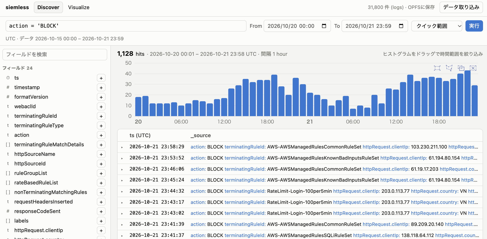

# siemless



フロントエンドだけで動く簡易 SIEM。DuckDB-Wasm をエンジンに、ログの検索(Discover)と最小限のグラフ作成ができる。
ログはブラウザの外に送信されず、OPFS (`opfs://siemless.db`) に保存されるのでリロード後も残る。

```sh
npm install
npm run dev        # http://localhost:5173
npm run build      # 静的ファイルを dist/ に出力
npm run gen:sample # サンプル WAF ログを再生成 (public/sample/waf-sample.ndjson.gz)
```

## 使い方

1. 「データ取り込み」から読み込む。
   - ファイル選択 / ドラッグ&ドロップ: NDJSON, JSON, CSV, Parquet (`.gz` 可)
   - URL: CORS が許可された Parquet / NDJSON など (DuckDB が HTTP で直接読む)
   - 「サンプルAWS WAFログ」: `public/sample/` の合成ログ (約 3 万件、7 日分)
2. **Discover**: 検索バーに SQL の WHERE 句を書く。時間範囲は From/To、またはヒストグラムのドラッグで絞る。
   フィールド一覧から上位値を見て ＋/− でフィルタ追加、列の追加もできる。行を開くと全フィールドを確認できる。
3. **Visualize**: 棒 / 折れ線 / エリア / 円 / テーブル。メトリクス (count, unique count, sum, avg, min, max)、
   X 軸 (Date histogram / Terms)、系列分割を選ぶ。生成された SQL は直接編集できる。

## 仕様メモ

- 取り込み時に時刻列 (`timestamp`, `@timestamp`, `time` 等) から `ts` 列 (UTC) を作る。画面上の時刻はすべて UTC。
- テーブルは `logs` 1 つ。ネストした struct は `httpRequest.clientIp` のようにそのまま参照できる。配列型は集計対象外。
- サンプルは AWS WAF のログ形式 (https://docs.aws.amazon.com/waf/latest/developerguide/logging-fields.html) に沿った合成データ。
  実ログではない。
- `@duckdb/duckdb-wasm` は安定版 1.32.0 に固定している (npm の `latest` タグは開発版を指し、その版では OPFS への書き込みが反映されなかった)。
